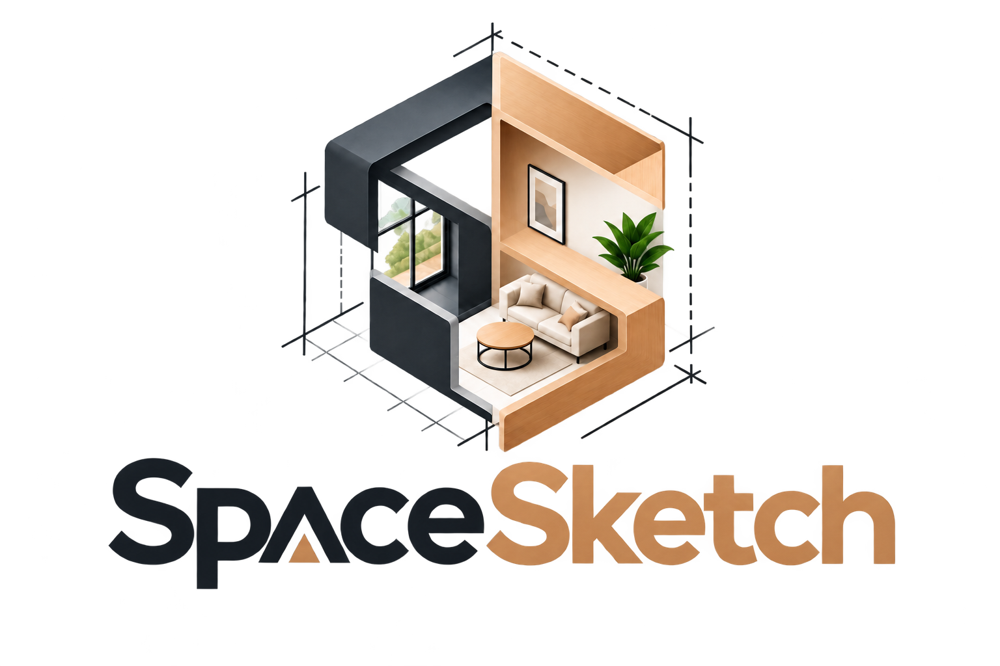

<p align="center">
  
</p>

# SpaceSketch

Design interior and outdoor spaces with a connected **2D floor plan and 3D editor**. Draw rooms, resize walls, place furniture, edit windows and doors, and add outdoor surfaces.

SpaceSketch works locally without an account. Supabase provides optional authentication, cloud storage for projects, version history, and shared viewing.

## Quick start

Prerequisites: Node.js 22.12 or newer, npm, and a browser with WebGL support for 3D editing. Development has been verified with Node.js 24.

From the repository root:

```sh
npm run setup
npm run dev
```

Open [localhost:3000](http://localhost:3000). No environment variables are required for local demo mode.

`npm run setup` installs the locked dependencies in `frontend/`. Root scripts forward to that package. You can also run `npm ci` and `npm run dev` directly from `frontend/`.

On Windows PowerShell, use `npm.cmd` if execution policy blocks `npm.ps1`.

## Features

### Rooms, walls, and openings

- Eight starter layouts, including furnished bedrooms, kitchens, offices, a two-room studio apartment, and an outdoor patio with lawn and a path.
- Up to 20 independent floors with names, elevations, switching, deletion, and undo. Older projects open as the ground floor; shared links include a read-only floor selector.
- Rectangular and polygon rooms, connected walls, wall splitting, room resizing, and visibility controls.
- Drag numbered room-corner handles in 2D or edit coordinates in Properties. Connected boundaries follow, and invalid room polygons are rejected.
- Draw a curved wall with three clicks (start, control point, end), or bend a selected wall using **Curve this wall**. Curves use 16 connected editable segments; bending a room wall also reshapes its floor.
- Live wall resizing with handles at both endpoints and the top in 3D; endpoint and height controls in 2D. Connected room boundaries follow the changes.
- Draggable windows and doors with width, height, sill, and position controls. Choose classic, sliding, or double styles.
- Opening fit and overlap validation. Live handle previews keep the last valid geometry, support Escape cancellation, and commit one undo step on release.
- 2D alignment guides, furniture center/edge snapping, wall-edge snapping, opening positioning assistance, and spacing labels.

### Furniture and materials

- **29 furniture types** with rendered 3D catalog thumbnails and icon fallbacks.
- Search by name, furniture type, or category using multiple terms. Star catalog pieces and use the Favorites filter; favorites persist in this browser and synchronize across its tabs.
- Adjustable straight staircases: edit width, run (depth), rise (height), rotation, and finish.
- Indoor pieces plus garden benches, loungers, umbrellas, pergolas, planters, trees, hedges, fences, and a barbecue.
- Move, resize, rotate, duplicate, lock, delete, and group-drag furniture. Use transform gizmos in 3D or precise property inputs.
- Visual material library with oak/walnut, tile, concrete, fabric, plaster, and paint presets. Apply finishes to rooms, walls, and procedural furniture; imported models retain their embedded materials.
- Red placement highlights in 2D and 3D, with selectable text warnings for overlapping furniture and blocked door approaches. Checks reserve 90 cm on both sides of doors and exclude rugs and wall art.
- Import self-contained GLB/glTF models with license and attribution information. External model dependencies are not supported.

### Outdoor design

Draw rectangular **patios, grass, paths, pools, and terrain** from **Build** or **Furniture → Outdoor**. Edit size, position, rotation, color, and elevation. Terrain patches also support a linear slope.

These are editable design surfaces. Terrain sculpting, excavation, and pool simulation are not implemented.

### Viewing and interaction

- 2D, 3D, and split views; six camera presets and an isometric wall cutaway.
- Day/evening lighting, sun direction, lamp lights, shadows, ceiling visibility, and quality settings.
- Per-lamp on/off, brightness (0?200%), and color temperature (1800?6500 K) controls in Lighting or selected-lamp Properties. Settings support undo and are saved with each floor, including JSON backups and shared views. Color temperature is an artistic approximation, not photometric calibration.
- Desktop walkthrough with WASD movement and pointer-lock mouse look.
- Mobile touch targets, collapsible library and properties panels, 2D pinch zoom/pan, and 3D zoom/orbit/pan/reset buttons.
- Measurements in meters, centimeters, feet, or inches; user-entered budget estimates.
- Keyboard-accessible object selectors, visible focus outlines, labeled toolbar actions, reduced-motion styles, and focus trapping/restoration in account and sharing dialogs.

### Dashboard previews and shopping lists

- Dashboard cards show automatically fitted isometric previews of the saved floor, including rooms, wall cutaways, door gaps, windows, furniture footprints, and outdoor surfaces. These are simplified geometry previews, not cached screenshots or full model renders.
- Open **Costs** for a furniture breakdown across all floors. Each piece belongs to the smallest room containing its center; other pieces appear under **Outdoor / unassigned**. Identical items are grouped by room, with quantity and subtotal.
- Enter prices in furniture Properties, then use **Export shopping list (CSV)** in Costs or the Export menu. The spreadsheet includes floor, room, dimensions, finish, quantity, unit price, and totals. Zero/unset prices are flagged in the panel. Amounts use your entered currency without conversion.

### Saving and sharing

- Local autosave, interrupted-session recovery, revision checks, and up to 100 undo steps.
- Export JSON backups, PDF floor plans for the current floor with wall/opening dimensions and custom measurements, high-resolution PNG/JPEG views (up to 3840 pixels wide), and GLB geometry for the current floor. JSON backups retain every floor. Images retain the viewport aspect ratio; image and GLB exports require a visible 3D view.
- Optional Supabase sign-in, cloud save/load, historical versions, and revocable read-only sharing links.

## Editor guide

| Task                   | How                                                                                                                          |
| ---------------------- | ---------------------------------------------------------------------------------------------------------------------------- |
| Draw a room or wall    | Open **Build**, choose a tool, then tap a start and end point. For a polygon, tap its corners and return to the first point. |
| Resize a wall          | Select it and drag the endpoint or height arrows. Geometry updates live; release to commit.                                  |
| Add a door or window   | Choose **Add door** or **Add window**, then tap a wall.                                                                      |
| Edit an opening        | Drag it along its wall in 2D, or use the Move, Width, and Height handles in either view. Choose its style in Properties.     |
| Add furniture          | Click a catalog card or drag it into the 2D plan. Select it to adjust dimensions and materials.                              |
| Add an outdoor surface | Choose **Draw patio/grass/path/pool/terrain**, then tap two opposite corners.                                                |
| Use alignment guides   | Enable snapping in the bottom toolbar; guides appear during supported 2D placement interactions.                             |
| Make space on mobile   | Collapse Properties using its heading button; the object stays selected.                                                     |
| Navigate 3D            | Orbit, pan, and zoom with gestures or the camera buttons. Use **Reset camera** to return to the overview.                    |

| Shortcut                       | Action                                                                                               |
| ------------------------------ | ---------------------------------------------------------------------------------------------------- |
| Ctrl/Cmd+Z                     | Undo                                                                                                 |
| Ctrl/Cmd+Shift+Z or Ctrl/Cmd+Y | Redo                                                                                                 |
| Ctrl/Cmd+D                     | Duplicate selected furniture                                                                         |
| Ctrl/Cmd+S                     | Save                                                                                                 |
| Delete                         | Delete selection; locked furniture is preserved                                                      |
| Escape                         | Cancel drawing or a handle preview; release selection or exit presentation/walkthrough as applicable |

Local projects are stored in the current browser under `spacesketch-projects-v1`. Export JSON backups before clearing browser data. Local projects do not automatically appear in another browser or device.

## Repository structure

```text
SpaceSketch/
├── frontend/
│   ├── app/                    Next.js routes and styles
│   ├── components/             Editor, 2D/3D views, controls, and previews
│   ├── lib/                    Models, geometry, placement, and persistence
│   ├── stores/editor.ts        Project state, live previews, and undo history
│   ├── public/                 Logo and other static assets
│   ├── tests/                  Unit and browser tests
│   ├── .env.example            Public Supabase configuration template
│   └── package.json            Application dependencies and scripts
├── backend/
│   └── supabase/migrations/    Database schema, functions, and access policies
├── package.json                Root command shortcuts
└── README.md
```

The frontend uses Next.js, React, TypeScript, React Three Fiber/Three.js, React Konva, Zustand, and Zod. One project document drives both views; temporary drag previews are kept out of saved data. Coordinates use X/Z for the floor plane and Y for height, with dimensions stored in meters.

The backend runs on Supabase; there is no separate Node.js backend server to start. The browser client stays in `frontend/lib/supabase.ts`.

See the [frontend README](frontend/README.md) and [backend README](backend/README.md) for folder-specific setup.

## Optional Supabase setup

1. Create a Supabase project and run [001_initial.sql](backend/supabase/migrations/001_initial.sql) in its SQL editor.
2. Enable email/password authentication.
3. Copy `frontend/.env.example` to `frontend/.env.local` and fill in the public credentials:

   ```dotenv
   NEXT_PUBLIC_SUPABASE_URL=your-project-url
   NEXT_PUBLIC_SUPABASE_ANON_KEY=your-public-anon-key
   ```

4. Set the Auth Site URL to your frontend URL. Allow `http://localhost:3000/reset-password` and the production `/reset-password` URL for password recovery.
5. Restart the frontend, open the account menu, and sign in. Save to sync a project, use **Load cloud projects** on another device, and use **Share** to manage links and versions.

Only public browser credentials belong in these variables. Do not expose a service-role key.

The backend uses row-level security and database functions for ownership checks, optimistic revision checks, version history, and shared reads. Anyone with an active sharing token can read that project; revoking the link removes its token.

**Live Supabase integration has not been verified against a configured project in this workspace.** Before deployment, verify authentication, owner isolation, concurrent saves, version restoration, sharing/revocation, and storage permissions. The SQL validation does not duplicate every client-side geometry constraint.

## Commands and verification

Run these from the repository root:

| Command                | Purpose                                                                                                                               |
| ---------------------- | ------------------------------------------------------------------------------------------------------------------------------------- |
| `npm run setup`        | Install frontend dependencies from the lockfile                                                                                       |
| `npm run dev`          | Start the development server                                                                                                          |
| `npm run typecheck`    | Check TypeScript                                                                                                                      |
| `npm run lint`         | Run ESLint                                                                                                                            |
| `npm run format`       | Format frontend, backend scripts, and documentation with Prettier                                                                     |
| `npm run format:check` | Check formatting without changing files                                                                                               |
| `npm test`             | Run unit tests                                                                                                                        |
| `npm run test:e2e`     | Run Playwright browser tests                                                                                                          |
| `npm run test:cloud`   | Verify a configured Supabase backend with two dedicated test accounts; see [backend setup](backend/README.md#live-cloud-verification) |
| `npm run build`        | Build for production                                                                                                                  |
| `npm start`            | Serve the production build; run build first                                                                                           |

The last verified feature update passed the production build, lint, **70 unit tests**, and **21 browser tests**. Coverage includes geometry, snapping, schema compatibility, live previews and undo, opening edits, outdoor surfaces, persistence, imports/exports, catalog thumbnails, and mobile controls.

Playwright is configured to use installed **Google Chrome**. It starts a local development server when needed and can reuse an existing one. Screenshots and failure artifacts are written to `frontend/test-results/`, which Git ignores.

Dependency audit results change over time. To inspect the current frontend dependencies, run:

```sh
npm --prefix frontend audit
npm --prefix frontend audit --omit=dev
```

## Deployment

For a Vercel deployment, use these project settings:

| Setting         | Value           |
| --------------- | --------------- |
| Root directory  | `frontend`      |
| Framework       | Next.js         |
| Install command | `npm ci`        |
| Build command   | `npm run build` |

Use a Node.js version compatible with the local setup. Configure the two public Supabase variables if cloud features are needed, apply the migration, and add the deployed URL to the Supabase authentication settings. Without Supabase configuration, the app runs in local demo mode.

## Current limitations

- Floors are shown separately, not as a stacked whole-building view. Elevation is floor metadata; staircases are visual models, without automatic ceiling cutouts or stair walking physics.
- Curves are segmented approximations. Openings must fit within an individual segment; remove openings before bending a wall. Standalone curves do not automatically create a room floor.
- No full constraint solver, viewport rulers, or automatic placement suggestions.
- Standalone wall loops do not automatically create floors. Use the polygon room tool; overlapping room floors are not merged automatically.
- Collision warnings do not prevent every overlap. Walkthrough uses simplified collision geometry and is intended for desktop use.
- Outdoor surfaces are rectangular; terrain supports a linear slope rather than freeform sculpting. Walkthrough does not simulate terrain or water physics.
- Imported models must be self-contained and no larger than 2.9 MB. Embedded assets count toward the 5 MB project limit and browser storage quota.
- Cloud asset uploads, automatic retry queues, and complete server-side geometry validation need further work. Cloud features require live integration testing.
- No real-time collaboration, AI design service, supplier pricing, or photorealistic rendering. Budget totals use prices entered by the user.
- Broader accessibility, browser, and device testing is still needed.

Built-in furniture geometry and procedural textures are authored in the project. The SpaceSketch logo is supplied by the project owner; imported models retain user-provided license and attribution information.

### Offline cloud sync and version comparison

Signed-in saves are stored locally and queued per Supabase account. While the app is open, reconnecting retries pending saves automatically (also every 15 seconds). Queues survive reloads; signing out pauses that account's queue. Network failures retry, while server rejections pause the affected project. The sync notice lets you preserve conflicting work as a separate cloud project; load cloud projects afterward to access the remote version. No automatic overwrite or merge occurs. Keep this browser's storage until syncing completes. Offline editing requires an already-loaded app; offline cold starts and background syncing with the app closed are not supported.

Open Share to compare the current design with an earlier session state or load cloud version history and select any two revisions. The read-only, side-by-side isometric geometry previews include a floor selector and item counts; they use simplified furniture shapes, not photorealistic renders. Both previews share the same scale. Comparison does not restore or modify either version. Offline queue tests cover reconnects, account separation, edits during upload, and conflict preservation; the browser sync test mocks Supabase responses and does not modify live cloud data.

### Eye-level walk-through

Choose **Walkthrough** in the editor to start at a free spot on the current floor. Drag the scene to look, use **WASD / arrow keys** to move and **Q / E** to turn, or hold the on-screen movement buttons on touch devices. **Reset position** returns to the starting spot; **Exit walkthrough** or **Escape** returns to the orbit view. Speed and eye height remain adjustable in camera settings.

Movement stops when focus leaves the page or enters a text field. Walls and furniture block movement, with sliding along obstacles and passage through sufficiently wide/tall doors (shown open during the tour). Movement stays on the selected floor at fixed eye height; stairs and sloped terrain do not change elevation automatically.

### Roofs, balconies, fences, and exterior finishes

Open **Build > Roof & exterior** to add a roof, balcony, or boundary fence. Roofs start over the current floor's wall bounds with a 30 cm overhang. Properties supports flat, gable, and shed roofs; roof rise; railing height; solid/picket fences; position, dimensions, elevation, rotation, and color. Choose an exterior finish after selecting a structure or wall (wall finishes apply to both sides). **Show roofs in 3D** temporarily hides roofs for interior editing; hidden roofs are omitted from 3D image/GLB exports.

Exterior structures use rectangular footprints, with dashed outlines in 2D. Drag an outline or use the object selector and Properties to edit it. They support undo, duplication, deletion, per-floor persistence, JSON/cloud snapshots, PDF footprints, 3D image/GLB exports, and simplified dashboard previews. Balconies have railings on three sides and an open rear edge. Fence panels block the fixed-height walk-through. Structural items are excluded from the furniture shopping list. Automatic roof trimming, structural engineering, multi-floor assemblies, and stair/elevation navigation are not included.
